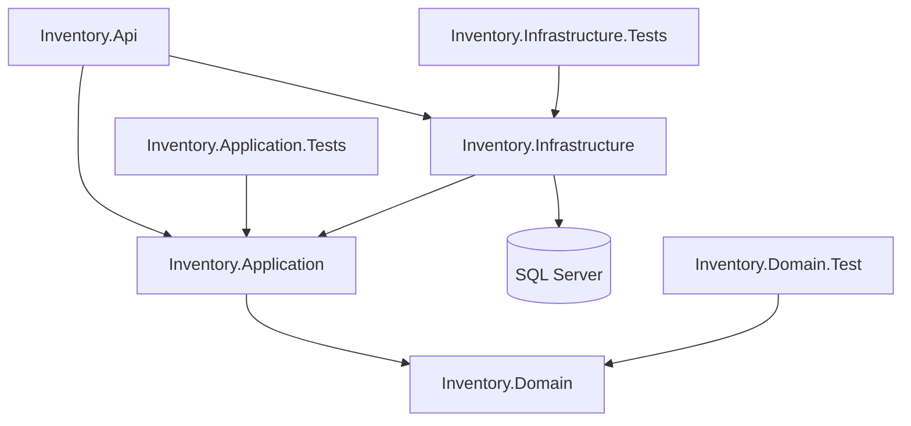
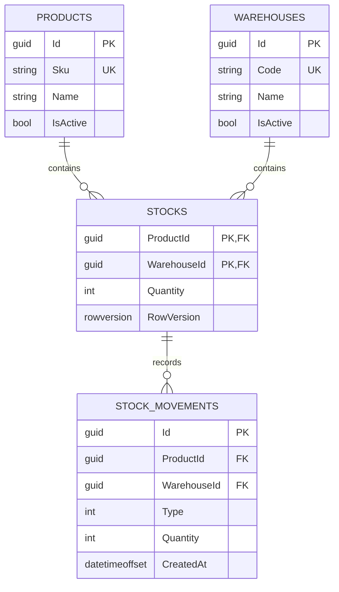

# Arquitectura e inventario

## Dependencias



Api es el composition root: registra implementaciones de Infrastructure para contratos de Application. Application no referencia EF ni ASP.NET. Domain no referencia las otras capas. Infrastructure accede a Domain transitivamente a través de Application.

## Modelo



Los constructores originales normalizan y validan. Stock.Receive usa checked; Stock.Withdraw impide negativos. StockMovement conserva cantidad positiva y tipo Entry/Exit; el signo se interpreta al calcular el saldo. CreatedAt usa UTC. Los identificadores son creados por el dominio; EF configura ValueGeneratedNever.

Configuraciones: `Inventory.Infrastructure/Persistence/Configurations/EntityConfigurations.cs`. SKU y Code tienen índices únicos. Stock tiene PK compuesta. Checks SQL impiden Quantity negativa, movimiento no positivo y enum fuera de 1/2. La FK compuesta desde movimientos impide un historial sin Stock. DeleteBehavior.Restrict evita cascadas destructivas. No hay endpoints de borrado.

## Casos de uso

| Caso de uso | Operación |
| --- | --- |
| CreateProductUseCase | Construir entidad, comprobar SKU, añadir y guardar |
| GetProductsUseCase | Listar con orden estable y paginación |
| GetProductByIdUseCase | Consultar o indicar recurso ausente |
| CreateWarehouseUseCase | Construir entidad, comprobar Code, añadir y guardar |
| GetWarehousesUseCase | Listar con paginación |
| GetStockUseCase | Consultar combinación; conserva contrato Stock? existente |
| RegisterStockEntryUseCase | Validar referencias y registrar entrada atómica |
| RegisterStockOutputUseCase | Validar referencias y registrar salida atómica |
| GetStockMovementsUseCase | Consultar historial filtrado y paginado |

GetStockUseCase conserva el contrato usado por la prueba Moq existente. El Controller lo convierte a StockDto y traduce null a 404. Los demás casos devuelven DTOs. MovementRegistration comparte exclusivamente la coordinación de entrada/salida; la regla de cantidad y mutación sigue en Domain. El repositorio transaccional tiene un contrato explícito: aplicar Stock y guardar historial juntos.

## Flujo transaccional

1. MVC hace binding y validación de la solicitud.
2. Application construye StockMovement y valida producto/almacén.
3. RegisterAsync abre una transacción ReadCommitted.
4. Lee Stock con tracking y su rowversion original. Una entrada puede crear Stock; una salida sin stock produce 409.
5. Invoca Receive o Withdraw en la entidad. Un error conserva el estado persistido.
6. Añade StockMovement y ejecuta SaveChangesAsync.
7. Hace commit. Solo después el Controller responde 201.

Si falla la escritura de cualquiera de las entidades, el await using dispone la transacción y revierte ambas. Una excepción puede dejar objetos en memoria modificados; el DbContext Scoped termina con la solicitud y no se reutiliza tras fallar. Las altas de catálogo usan IUnitOfWork/UnitOfWork.SaveChangesAsync, cuyo SaveChanges es transaccional por defecto.

## Decisión: optimistic concurrency con rowversion

La propiedad de sombra RowVersion usa IsRowVersion: SQL Server genera un token binario nuevo por actualización, que no representa una fecha. EF conserva el valor leído. Conceptualmente:

```sql
UPDATE Stocks
SET Quantity = @newQuantity
OUTPUT INSERTED.RowVersion
WHERE ProductId = @productId AND WarehouseId = @warehouseId
  AND RowVersion = @originalVersion;
```

Con una unidad, si ambos leen la misma versión, solo un UPDATE afecta una fila. El otro provoca DbUpdateConcurrencyException; PersistenceErrors lo traduce a InventoryConflictException y el HTTP es 409. Si la segunda solicitud lee después del primer commit, Withdraw se rechaza por insuficiencia, también con 409. En ambos casos solo se persiste una salida. El token no se expone en DTOs: aquí protege la operación interna de cada comando, no una edición desconectada del cliente.

La inicialización simultánea de Stock aún no tiene rowversion previo. La PK compuesta permite una sola creación: el error SQL 2601/2627 se convierte en 409. No hay retry automático ni relectura silenciosa, para no repetir un movimiento que el cliente no haya aprobado. Los conflictos se comunican para conciliación y una nueva decisión explícita.

ReadCommitted limita lecturas sucias; no basta para evitar Lost Update en un read-modify-write. El token resuelve esa ventana y la transacción agrupa Stock/historial. SQL Server sigue usando bloqueos internos de escritura: optimistic no significa ausencia absoluta de locks.

### Alternativas evaluadas

| Estrategia | Cuándo usarla | Trade-off aquí |
| --- | --- | --- |
| Rowversion (elegida) | Agregados con reglas en entidades y contención moderada | Requiere detectar conflictos y tratarlos; no evita reintentos del cliente |
| UPDATE condicional atómico | Mucha contención y regla simple, p. ej. Quantity >= @amount | Eficiente, pero la lógica SQL replica invariantes del dominio y aun necesita transacción con historial |
| UPDLOCK/HOLDLOCK o Serializable | Lectura y decisión deben serializarse, incluso rangos ausentes | Mayor bloqueo, riesgo de deadlock y menor throughput |

No se usa lock de C#: solo protegería un proceso. No se usa InMemory para demostrar garantías SQL. El escenario HTTP simultáneo fue reproducido contra SQL Server real y complementado por una integración que sincroniza los dos escritores antes de guardar. Evidencia y límites están en VERIFICATION.md.

## Consultas y errores

Lecturas usan AsNoTracking y consultas async con CancellationToken. AnyAsync comprueba existencia sin traer listas. Orden estable, Skip/Take y máximo 100 limitan memoria y transferencia. El historial tiene índice por producto/almacén/fecha; consultas solo por almacén o páginas profundas pueden requerir otros índices o keyset pagination tras medir. No se cargan navegaciones ni hay lazy loading, evitando N+1 en este MVP.

El chequeo previo de duplicados mejora el mensaje, pero el índice único es la garantía ante carreras. SqlClient parametriza LINQ; no se concatena entrada en SQL. PersistenceErrors solo expone mensajes de negocio controlados. ApiExceptionHandler registra traceId y retorna ProblemDetails sin stack traces; un fallo desconocido produce 500 genérico. La validación de MVC produce ValidationProblemDetails 400.

## DI, patrones y límites

- DbContext, repositorios, UnitOfWork y casos de uso: Scoped, comparten unidad de trabajo por solicitud.
- IExceptionHandler: Singleton administrado por ASP.NET; no captura DbContext. DatabaseHealthCheck crea un scope para acceder a él.
- Transient es adecuado para lógica sin estado, pero no hace falta registrarla en este MVP.
- Repository encapsula consultas; Unit of Work encapsula SaveChanges para catálogo. EF ya aporta tracking y transacciones; no se añade un repositorio genérico.
- No se añaden MediatR, CQRS separado, Factory Method, Strategy ni un bus de eventos sin una necesidad real. La guía incluye microejercicios de patrones, claramente separados de lo implementado.

## Seguridad

Solo Development; Program falla al arrancar en otros ambientes. Sin autenticación ni autorización, no es apto para exposición pública. Compose publica únicamente localhost y usa credenciales locales externas. Migraciones deben separarse de la identidad de runtime en un despliegue real. No hay idempotencia de comandos: una respuesta perdida después del commit no permite reintentar automáticamente con seguridad. No se habilita EnableRetryOnFailure para ocultar esta cuestión; una estrategia de resiliencia futura debe envolver la transacción y definir idempotencia primero.

Swagger está disponible en este entorno de desarrollo. Logs internos pueden contener detalles técnicos; deben protegerse y tener retención limitada.

Referencias de diseño: [EF Core concurrency](https://learn.microsoft.com/en-us/ef/core/saving/concurrency), [transacciones](https://learn.microsoft.com/en-us/ef/core/saving/transactions), [tracking](https://learn.microsoft.com/en-us/ef/core/querying/tracking).
